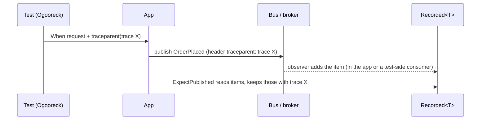

# Ogooreck 1.0: Emmett-shaped API specification

Revision: 16

## Problem Statement

Ogooreck's API testing helper, `ApiSpecification`, sends HTTP requests in Given and When and checks the HTTP response in Then. That covers a request–response API. It doesn't cover what an event-driven application does after the response: the messages it publishes, the events it appends, the trace it produces and the metrics it changes. When a read model updates asynchronously, tests fall back to `Until(...)`, which re-sends a request on a timer until it passes.

Emmett's `ApiE2ESpecification` and the Java version in EventSourcing.JVM (`samples/e-commerce`) test an application as a black box. Given steps describe what the outside world does, a single When step performs the action under test, and Then expectations check everything observable. Ogooreck should work the same way, for two reasons: a .NET test and a Java or Emmett test of the same behavior should read alike, and a later Java port of Ogooreck should be able to share the concepts and names without becoming a lowest common denominator. Where a detail is not settled otherwise, Ogooreck does what the Java version does.

The goal: Ogooreck users write API tests that check the response, published messages, appended events, causation, traces and metrics. The app can be hosted in-process (`WebApplicationFactory`) or out of process (Aspire), and can use any messaging tool. The tests need no fixed waits and can run in parallel.

## Solution

`ApiSpecification` keeps its name and gets the Emmett shape. It ships as Ogooreck 1.0.0, a breaking release with a migration guide. Business logic specifications (`DeciderSpecification`, `HandlerSpecification`) stay as they are.

### A test

```csharp
api.Given(AddProduct(cartId, "socks"))
   .When(PlaceOrder(cartId))
   .Then(
       ExpectResponse(HttpStatusCode.Created),
       ExpectPublishedIn(AppApi.PublishedMessages, new OrderPlaced(cartId)),
       ExpectTrace(Span("POST /carts/{id}/orders", Span("publish OrderPlaced"))));
```

A request step is a plain function of `HttpClient`, like Emmett's supertest lambdas and Java's `RestTestClient` lambdas, so there is no request DSL to learn. When a step needs an id the server generated, it takes a second argument that holds the earlier responses.

### Steps

Given takes any number of steps; When takes one. A step is one of:

- **Request**: an HTTP request. A failing Given request fails the test.
- **Attempt**: a Given request that is allowed to fail.
- **Action**: any code, such as advancing a fake clock or triggering a job.
- **Publish**: puts messages on the app's bus, as another module or system would, through a publish function the user plugs in.
- **Eventually**: a When request that is re-sent only while its response expectations fail, until they pass or the deadline is reached. It is opt-in, and it replaces `Until` for apps that have no idle signal.

### Trace context ties everything to the test

Each step gets a fresh W3C `traceparent`. Ogooreck sends it with every request, and actions and publish functions receive it. The app propagates it into the spans it creates and the messages it sends. Attribution then works like this:

- **Messages and events** count as the When step's only when they carry the When step's trace id. Messages from Given steps, from other tests on the same broker, and late arrivals don't count.
- **Spans and in-process measurements** count when they carry the trace id of any of the test's steps, Given or When, as in the Java version. Each step's spans form their own trace, and causation between spans is checked within a trace, as in Java.

This makes parallel tests against shared brokers and databases safe.



### Plugging in a messaging tool or event store

Ogooreck works as the Java version does: it records what the app publishes and appends through decorators on the app's own services, and after each step it asks each tool whether it has caught up (answers 57, 65, 68).

The core hook is `Recorded<T>`, a pipe that code writes to and Ogooreck reads, plus `Recording(recorded, read, catchUp)`. `T` is whatever the tool gives: a Kafka message, a Marten event or a Wolverine envelope. The `read` function turns an item into a message plus its `traceparent`, and for causation checks also returns the message, correlation and causation ids. The optional **catch-up function** tells Ogooreck when the tool is idle, as Java's `whenCaughtUp` does. With catch-up, Ogooreck can check "exactly these messages" and "nothing published". Without it, Ogooreck can only check that the expected messages arrived.

Users don't have to write that wiring. A **plugin** does it in one call, `Use(plugin)`, and plugins compose (answer 72):

```csharp
public static class Messaging
{
    public static readonly KafkaPlugin Kafka = KafkaPlugin.Decorating();
}

public class AppApi() : ApiSpecification<Program>(spec => spec.Use(Messaging.Kafka));

// in a test
ExpectPublishedIn(Messaging.Kafka.Published, new OrderPlaced(cartId), new ShipOrder(cartId))
```

Ogooreck ships one plugin package per tool, so the core package references no broker client (answer 69):

| Package | Records through | Catches up through, as Java does |
|---|---|---|
| `Ogooreck.Kafka` | A decorator on the app's `IProducer<TKey, TValue>`; or, for an out-of-process app, a test-side consumer | A decorator on the app's `IConsumer<TKey, TValue>`: each consumer back in `Consume` with its positions at the end offsets (as Java's `KafkaMessageBus`, from the app's side) |
| `Ogooreck.RabbitMQ` | A decorator on the app's `IConnection` (in-process apps only) | A probe message per queue the app consumes (Java's `RabbitMQMessageBus`), plus tracking of running handlers and requeues in the decorated consumer |
| `Ogooreck.Marten` | A Marten listener registered in the test host | Marten's projection wait |
| `Ogooreck.Wolverine` | Wolverine middleware registered in the test host | Wolverine's tracked session |

A user with another tool writes a plugin the same way, or calls `Recording(...)` directly. Core helps with both: a DI decorator helper for the app's services, and a message reader for a recommended set of headers (answers 58, 70).

Recording never blocks the tool, and production code never references anything Ogooreck ships.

### No fixed waits

A passing test never sleeps. After each step, Ogooreck runs the plugged catch-up functions until a round produces nothing new. Expectations that need time wait for their condition and fail at a deadline (30 seconds by default). The deadline only bounds failure.

### Hosts and setup

| Setup | What Ogooreck does by default |
|---|---|
| `IClassFixture<ApiSpecification<Program>>`, or `ApiSpecification.For<Program>()` | Starts `WebApplicationFactory<Program>`, takes JSON options from the app's services, listens to traces and metrics in-process, deadline 30 s. |
| `ApiSpecification.For(async () => app.GetEndpoint("api"))`, or `.Host(async () => app.GetEndpoint("api"))` in a subclass's configuration (Aspire, or any base address) | Builds its own client for that address. JSON web defaults, telemetry off, deadline 30 s. |

Rule: Ogooreck turns on what it can do safely by itself. Anything that needs the app or infrastructure is opt-in: plugins, recorders, catch-up, publishing, and the OTLP receiver. Each configuration call replaces its default. Configuration happens before the first step, as in Java, where settings belong to the specification class.

The entry point creates the one app: `ApiSpecification.For<Program>()`, `new ApiSpecification<Program>()` or a subclass. A test that needs other test setup, such as a shorter deadline, another catch-up or a plugin option, calls `spec.With(configure)`: it returns a specification that runs on the same running app, with the test setup copied and then changed, and disposing it leaves the app running. Test setup is `Deadline`, `Recording`, `CatchUp`, `Publishing`, `Telemetry`, `Json` and plugin options; a variant shares the app's telemetry source unless it sets its own. The host customization is given at construction, `For<Program>(host)` or the base constructor `(host, configure)`, so a variant has no way to change the host (answer 97). A plugin that changes the app's services and isn't in the app's setup throws inside `With`: "Plugin X changes the app's services, so it can't run on the shared app. Add it to the app's setup, or use WithNewApp(...) to start a separate app for it." `spec.WithNewApp(configure)` is the explicit way to start a separate app, with the same host customization, plugins and test setup, then the changes; each call costs an app start (answer 96). Out of process, a second specification costs only an HTTP client, so `With` is in-process only.

When a project uses one setup everywhere, for example Wolverine, it writes that setup once, in one class such as `AppApi`, usually as a few `Use(...)` calls. That class can subclass `ApiSpecification<Program>` and pass its configuration to the base constructor, or a fixture can hold `ApiSpecification.For<Program>()...`. Every test class reuses that class through its framework's fixture mechanism: `IClassFixture`, a collection or assembly fixture, NUnit `SetUpFixture` or MSTest `AssemblyInitialize`. The host starts on the first step, so async hosts like Aspire need no async fixture hook.

### Checking messages and events without naming a recorder

As in Java, where the specification has one list of published messages and one of appended events, a recorder has a role. `Recording(...)` registers the messages the app publishes, and `Appending(...)` registers the events it appends; the plugins do the same (the Kafka, RabbitMQ and Wolverine plugins record published messages, the Marten plugin appended events). `ExpectPublished(messages...)`, `ExpectNothingPublished()`, `ExpectAppended(events...)`, `ExpectNothingAppended()` and the causation nodes `Published(...)`, `Sent(...)` and `Appended(...)` check the specification's one recorder of that role. With none, they fail saying to add a plugin or register one; with more than one, they fail saying to name it. A specification with several recorders of one role names the one to check with the `...In` form: `ExpectPublishedIn(broker.Consuming.Published, new OrderPlaced(cartId))`, `ExpectNothingPublishedIn(...)`, `ExpectAppendedIn(...)`, `ExpectNothingAppendedIn(...)`, `PublishedIn(...)`, `SentIn(...)` and `AppendedIn(...)`. The named form has its own name instead of an overload, so no language can pick the wrong one: F# prefers a non-generic overload, and with two overloads it took the recorder for an expected message (answer 98).

### An app without a `Program` class

`ApiSpecification.For(host)` takes a started host that the test built itself with `UseTestServer()`, for example `new HostBuilder().ConfigureWebHost(web => web.UseTestServer()...).StartAsync()`. Requests go to its test server; JSON options come from the host's services and traces and metrics are read in-process, as with `For<Program>()`, and plugins can read `AppServices`. The caller owns the host: it configures the app's services when building it, and stops and disposes it. A host without a test server throws, naming `UseTestServer()` and `For(async () => address)` (answer 99).

### Traces and metrics

In process, Ogooreck listens to all `Activity` sources and `Meter` instruments. Out of process (Aspire), Ogooreck hosts an OTLP/HTTP receiver in the test, and the app's resources export to it. Both feed the same expectations: a span tree, correlated traces, and a metric's increase. Some measurements have no trace id and can't be tied to a test: observable instruments, counters recorded outside any request's activity, and OTLP data points. The docs tell users to filter them by a tag unique to the test, or to run those metric tests serially. OTLP data arrives in periodic exports, so an increase from a Given step can arrive after the baseline. By default that is a documented limitation: tag OTLP metrics with something only the When step touches. The OTLP receiver can opt in to waiting for the next export before the baseline and before each check.

## Acceptance criteria

The examples use a cart and order sample app, and `cartId` is a new `Guid` in each test. `AppApi.PublishedMessages` is the test project's `Recorded<T>` for published messages, and `AppApi.AppendedEvents` is the one for appended events. "Configured with a 2-second deadline" means a specification instance created with `.Deadline(TimeSpan.FromSeconds(2))`.

### Setup and hosts

1. A user tests an in-process app with no configuration, so they can start testing with one line.
   1.1. GIVEN a test class with `IClassFixture<ApiSpecification<Program>>` WHEN it runs `Given(AddProduct(cartId, "socks")).When(GetCart(cartId)).Then(ExpectResponse(OK, Body(new { products = new[] { "socks" } })))` THEN the test passes, and only one `WebApplicationFactory<Program>` starts for the class.
   1.2. GIVEN `ApiSpecification.For<Program>()` with no further calls AND an app that serializes enums as strings WHEN the response contains `"status":"Placed"` THEN `Body(new { status = OrderStatus.Placed })` matches, because the app's JSON options are used.
2. A user configures the specification once per test project, so every test class shares it.
   2.1. GIVEN a class `AppApi : ApiSpecification<Program>` passing `Recording(...)` to the base constructor AND two test classes with `IClassFixture<AppApi>` WHEN both run THEN both use the recording, and neither repeats the configuration.
   2.2. GIVEN a fixture holding `ApiSpecification.For<Program>().Recording(...)` WHEN a test calls `Spec.Given(...).When(...).Then(...)` THEN it behaves the same as 2.1.
   2.3. GIVEN `AppApi` registered as an xUnit v3 assembly fixture WHEN 3 test classes run THEN one host starts in total.
   2.4. GIVEN `AppApi` as an assembly fixture AND a test class holding `app.With(spec => spec.Deadline(TimeSpan.FromSeconds(1)))` WHEN its expectation never holds THEN it fails after about 1 second, the app's own tests keep the 30-second deadline, and one host starts in total.
   2.5. GIVEN `app.With(spec => spec.Use(plugin))` for a plugin that changes services and isn't in the app's setup THEN it throws, naming the plugin and `WithNewApp(...)`.
   2.6. GIVEN `app.WithNewApp(host, spec => spec)` WHEN it runs a step THEN a second host starts, customized by the app's host function and then by `host`, with the app's plugins and test setup.
3. A user customizes the in-process host, so test-only hooks are registered.
   3.1. GIVEN `.Host(f => f.WithWebHostBuilder(...registers a publish observer...))` WHEN a When step publishes `OrderPlaced` THEN the observer adds it to `AppApi.PublishedMessages`.
4. A user tests an app hosted out of process, so Aspire apps can be tested.
   4.1. GIVEN `ApiSpecification.For(async () => app.GetEndpoint("api"))` WHEN the first step runs THEN the address function runs once, and requests go to that address.
   4.2. GIVEN that setup WHEN any request step runs THEN the request carries a `traceparent` header whose trace id is unique to that step.
   4.3. GIVEN `ApiSpecification.For(address, handlerFactory)` WHEN a request step runs THEN the request goes through the handler from `handlerFactory`, and still carries the step's `traceparent`.
   4.4. GIVEN a class `AspireApi : ApiSpecification` with a static `OtlpReceiver Otlp = OtlpReceiver.Start()` that passes to the base constructor an address function, which starts the app with `Otlp.Endpoint`, and `Telemetry(Otlp)` WHEN a test uses it as a fixture THEN it behaves the same as 4.1, and the app exports to `Otlp`.
   4.5. GIVEN a class `AspireApi : ApiSpecification` whose configuration calls `.Host(async () => app.GetEndpoint("api"))` WHEN the first step runs THEN it behaves the same as 4.1.
   4.6. GIVEN a class `AspireApi : ApiSpecification` whose configuration never calls `.Host(...)` and that passes no address WHEN the first step runs THEN it fails, saying that a host is required.
5. A user disposes the specification, so nothing keeps running after the tests.
   5.1. GIVEN a specification that started its own host and its default in-process telemetry WHEN it is disposed, synchronously or asynchronously, THEN both are stopped, AND an `OtlpReceiver` passed in with `Telemetry(...)` keeps running until the caller disposes it.
6. Configuration fully replaces a default and stays fixed after the first step, so tests that share a specification don't affect each other.
   6.1. GIVEN a specification configured with a 2-second deadline AND an expectation that never holds WHEN Then runs THEN it fails after about 2 seconds, not 30.
   6.2. GIVEN `.Telemetry(TelemetrySources.Off)` on an in-process host WHEN `ExpectTrace(...)` runs THEN it fails with a message saying telemetry is off.
   6.3. GIVEN a specification that has already run a step WHEN a test calls `.Deadline(...)` or any other configuration call on it THEN the call throws, saying that configuration must happen before the first step.
   6.4. GIVEN `.Json(options)` with `PropertyNamingPolicy = JsonNamingPolicy.SnakeCaseLower` WHEN the response is `{"order_status":"Placed"}` THEN `Body(new { OrderStatus = "Placed" })` matches. Without `.Json(...)`, on a host whose app uses the web defaults, the same check fails, because the expected value serializes as `orderStatus`.
   6.5. GIVEN a custom `ITelemetrySource` that adds one `RecordedSpan` named `custom` with the When step's trace id WHEN `ExpectTrace(Span("custom"))` runs THEN it passes.

### Steps

7. A user sends requests as plain `HttpClient` calls, so they need no Ogooreck request DSL.
   7.1. GIVEN `Request(client => client.PostAsJsonAsync($"/carts/{cartId}/products", new { product = "socks" }))` as a Given step WHEN the test runs THEN the app receives that POST with that body.
8. A user uses a server-generated id from an earlier response, so apps with server-generated ids stay testable.
   8.1. GIVEN a Given step whose response is `201 Created` with `Location: /carts/42` AND the When step `Request((client, ctx) => client.GetAsync($"/carts/{ctx.CreatedId()}"))` WHEN the test runs THEN the When request goes to `/carts/42`.
   8.2. GIVEN the same Given step WHEN the When step calls `ctx.CreatedId<int>()` THEN it gets `42`.
   8.3. GIVEN no earlier `201` response WHEN a step calls `ctx.CreatedId()` THEN the test fails, saying that no created response was found.
   8.4. GIVEN two Given steps WHEN the When step reads `ctx.Responses` THEN it gets both responses in step order.
9. A failing Given request fails the test, so a broken setup isn't mistaken for a passing scenario.
   9.1. GIVEN a Given request that returns `404` with body `{"title":"Cart not found"}` WHEN the test runs THEN it fails before the When step, and the message shows the status `404` and that body.
10. A user expects a Given request to fail, so they can set up a rejected attempt.
    10.1. GIVEN `Attempt(PlaceOrder(unknownCartId))` returning `404` as a Given step WHEN the test runs THEN the When step runs, and the test result depends only on the expectations.
11. A user runs any code as a step, so they can move time or trigger jobs.
    11.1. GIVEN `Action(ctx => { clock.Advance(TimeSpan.FromDays(1)); return Task.CompletedTask; })` as the When step AND the app expires the cart after 1 day WHEN `ExpectPublishedIn(AppApi.PublishedMessages, new CartExpired(cartId))` runs THEN it passes.
    11.2. GIVEN an action step WHEN it reads `ctx.Traceparent` THEN it gets a valid W3C `traceparent` whose trace id is unique to that step.
    11.3. GIVEN an action that starts an `Activity` with `ctx.Traceparent` as parent and publishes `ExpireCart` from it WHEN the app then publishes `CartExpired` THEN `ExpectPublishedIn(AppApi.PublishedMessages, new CartExpired(cartId))` attributes it to the When step.
12. A user publishes a message as another module would, so they can test message-driven entry points.
    12.1. GIVEN `.Publishing((request, ct) => bus.Publish(..., carrying request.Traceparent))` AND the When step `Publish(new PaymentConfirmed(orderId))` AND the app reacts by publishing `OrderPaid(orderId)` WHEN `ExpectPublishedIn(AppApi.PublishedMessages, new OrderPaid(orderId))` runs THEN it passes.
    12.2. GIVEN no `.Publishing(...)` WHEN a `Publish(...)` step runs THEN the test fails, saying that publishing needs a publish function.
13. A user re-sends a When request until a read model catches up, so apps without an idle signal stay testable.
    13.1. GIVEN `When(Eventually(GetOrder(orderId)))` AND the read model shows `"Placed"` only from the 3rd request WHEN `Then(ExpectResponse(OK, Body(new { status = "Placed" })))` runs THEN the request is sent 3 times, and the test passes.
    13.2. GIVEN a specification configured with a 2-second deadline AND a read model that never shows `"Placed"` WHEN the same test runs THEN it fails after about 2 seconds, with the last response's status and body.
    13.3. GIVEN `When(GetOrder(orderId))` without `Eventually` AND the read model shows `"Placed"` only from the 3rd request WHEN the same expectation runs THEN the request is sent once, and the test fails.
    13.4. GIVEN `Eventually(...)` used as a Given step WHEN the test runs THEN it fails, saying that `Eventually` is allowed only as the When step.
    13.5. GIVEN `When(Eventually(GetOrder(orderId)))` where each request publishes `OrderViewed(orderId)` AND the read model shows `"Placed"` from the 3rd request WHEN `Then(ExpectResponse(OK, Body(new { status = "Placed" })), ExpectPublishedIn(AppApi.PublishedMessages, new OrderViewed(orderId)))` runs on a recorder with catch-up THEN it passes. Only the final attempt's messages count, and `ExpectPublished` runs once, after the response expectations pass.
    13.6. GIVEN `When(Eventually(GetOrder(orderId)))` that needs 3 attempts, each creating span `GET /orders/{id}` WHEN `ExpectMetric("http.server.request.duration", { ["http.route"] = "/orders/{id}" }, 3)` runs in-process THEN it passes, because every attempt's trace id belongs to the test.
14. A user reuses a named group of steps, so scenarios read as the business story.
    14.1. GIVEN `TestStep[] cartWithSocks = [AddProduct(cartId, "socks")]` WHEN a test calls `Given(cartWithSocks, ConfirmCart(cartId))` THEN both steps run, in that order.
    14.2. GIVEN `cartWithSocks` WHEN a test builds `TestStep[] confirmedCart = Scenario(cartWithSocks, ConfirmCart(cartId))` and calls `Given(confirmedCart)` THEN both steps run, in that order.

### Messages and events

15. A user checks what the When step published, so they test the app's outgoing contract.
    15.1. GIVEN a recorder with a catch-up function AND the When step publishes `OrderPlaced(cartId)` WHEN `ExpectPublishedIn(AppApi.PublishedMessages, new OrderPlaced(cartId))` runs THEN it passes.
    15.2. GIVEN the same AND the When step also publishes `CartClosed(cartId)` after `OrderPlaced` WHEN `ExpectPublishedIn(AppApi.PublishedMessages, new OrderPlaced(cartId))` runs THEN it fails, listing the expected `OrderPlaced` and the published `OrderPlaced` and `CartClosed`, numbered.
    15.3. GIVEN the same WHEN `ExpectPublishedIn(AppApi.PublishedMessages, new CartClosed(cartId), new OrderPlaced(cartId))` runs THEN it fails, because the order differs.
    15.4. GIVEN the When step publishes `OrderPlaced(cartId)` with total `10` WHEN `ExpectPublishedIn(AppApi.PublishedMessages, new OrderPlaced(cartId) { Total = 20 })` runs THEN it fails, because messages are compared on all fields.
    15.5. GIVEN the When step publishes `OrderPlaced(cartId) { Products = ["socks", "shoes"] }` WHEN `ExpectPublishedIn(AppApi.PublishedMessages, new OrderPlaced(cartId) { Products = ["shoes", "socks"] })` runs THEN it fails, because nested collections are compared in order.
16. Messages from other steps and tests don't count, so tests can run in parallel on a shared broker.
    16.1. GIVEN a recorder with a catch-up function AND a Given step that publishes `ProductAdded(cartId)` WHEN the When step publishes only `OrderPlaced(cartId)` THEN `ExpectPublishedIn(AppApi.PublishedMessages, new OrderPlaced(cartId))` passes. It would fail if `ProductAdded` counted, because the check is exact.
    16.2. Removed (answer 53): parallel tests on one shared host are shown by 18.4 on Kafka. Wolverine's tracked sessions allow one session per host, so its sample runs serially, as Wolverine's docs do.
    16.3. GIVEN a recorded item whose `read` result has no `traceparent` AND the When step's own `OrderPlaced(cartId)` WHEN `ExpectPublishedIn(AppApi.PublishedMessages, new OrderPlaced(cartId))` runs on a recorder with catch-up THEN it passes, and the item without a `traceparent` doesn't count.
    16.4. GIVEN a Given step whose message arrives after the When step started WHEN the When step's expectations run THEN that message doesn't count, because it carries the Given step's trace id.
17. A user checks that nothing was published, so they test that a rejected command has no effect.
    17.1. GIVEN a recorder with a catch-up function AND a When step that publishes nothing WHEN `ExpectNothingPublishedIn(AppApi.PublishedMessages)` runs THEN it passes.
    17.2. GIVEN the same AND a When step that publishes `OrderPlaced(cartId)` WHEN `ExpectNothingPublishedIn(AppApi.PublishedMessages)` runs THEN it fails, listing `OrderPlaced`.
    17.3. GIVEN a recorder without a catch-up function WHEN `ExpectNothingPublishedIn(recorded)` runs THEN it fails at once, saying that it needs a catch-up function on that recorder.
18. A user checks messages without a catch-up function, so broker-side recording works without an idle signal.
    18.1. GIVEN a Kafka recorder without catch-up AND the When step publishes `OrderPlaced(cartId)` then `CartClosed(cartId)` WHEN `ExpectPublishedIn(kafka, new OrderPlaced(cartId))` runs THEN it passes as soon as `OrderPlaced` arrives.
    18.2. GIVEN the same WHEN `ExpectPublishedIn(kafka, new CartClosed(cartId), new OrderPlaced(cartId))` runs THEN it fails at the deadline, because the expected messages didn't arrive in that order.
    18.3. GIVEN a specification configured with a 2-second deadline AND an app that never publishes `OrderPaid` WHEN `ExpectPublishedIn(kafka, new OrderPaid(cartId))` runs THEN it fails after about 2 seconds, listing the messages it did see for the When step.
    18.4. GIVEN two tests running in parallel on one Kafka topic, where test A's When step publishes `StockChecked("socks")` and test B's When step publishes nothing WHEN test B runs `ExpectPublishedIn(kafka, new StockChecked("socks"))` on a specification configured with a 2-second deadline THEN it fails, because test A's message doesn't count.
19. A user checks appended events, so they test what the app stored.
    19.1. GIVEN a Marten recorder with a catch-up function AND the When step appends `OrderPlaced(cartId)` WHEN `ExpectAppendedIn(AppApi.AppendedEvents, new OrderPlaced(cartId))` runs THEN it passes.
    19.2. GIVEN the When step appends nothing WHEN `ExpectNothingAppendedIn(AppApi.AppendedEvents)` runs THEN it passes.
20. A user checks what caused what, so they test correlation and causation across modules.
    20.1. GIVEN the When step publishes `OrderPlaced` (id `m1`, correlation `c1`), which causes `ShipOrder` (causation `m1`, correlation `c1`) WHEN `ExpectCausation(PublishedIn(AppApi.PublishedMessages, new OrderPlaced(cartId), SentIn(AppApi.PublishedMessages, new ShipOrder(cartId))))` runs THEN it passes.
    20.2. GIVEN `ShipOrder` has causation `m9` WHEN the same expectation runs THEN it fails, naming the expected causation `m1` and the actual `m9`.
    20.3. GIVEN `ShipOrder` has correlation `c2` WHEN the same expectation runs THEN it fails, naming the expected correlation `c1`.
    20.4. GIVEN a recorder whose `read` doesn't return message ids WHEN `ExpectCausation(...)` runs THEN it fails, saying that it needs message, correlation and causation ids from `read`.
    20.5. GIVEN a Kafka recorder without catch-up AND `ShipOrder` arriving 500 ms after `OrderPlaced` WHEN the expectation from 20.1 runs on that recorder THEN it passes once `ShipOrder` arrives.
21. Recording never slows the tool, so tests measure the app, not Ogooreck.
    21.1. GIVEN an in-app observer that adds 10,000 items to a recorder that no expectation reads WHEN the When step runs THEN no `Add` call blocks or throws.

### Catch-up

22. Ogooreck waits for the app to settle after each step, so the next step sees the effects of the previous one.
    22.1. GIVEN `.CatchUp(ct => store.WaitForNonStaleProjectionDataAsync(...))` AND a Given step that adds a product WHEN the When step reads the cart THEN the projection already contains the product, without `Eventually`.
    22.2. GIVEN a recorder whose items cause handlers to publish more items WHEN catch-up runs THEN it repeats until a round adds no items, and only then runs the next step.
    22.3. GIVEN a specification configured with a 2-second deadline AND an app that keeps publishing forever WHEN a step runs THEN the test fails after about 2 seconds, saying that the app kept producing messages for longer than the deadline.
    22.4. GIVEN no catch-up function WHEN steps run THEN each step starts right after the previous one returned, with no delay.

### Plugins

36. A user adds a tool with one call, so setups compose instead of growing into per-project setup classes.
    36.1. GIVEN `.Use(new WolverinePlugin().MessageTypes(type => type.Namespace == typeof(OrderPlaced).Namespace)).Use(clock)`, where `clock` is a user class implementing `ISpecificationPlugin` that registers a `FakeTimeProvider` as the app's `TimeProvider` WHEN the When step is an action that advances `clock` by 1 day AND the app expires the cart THEN `ExpectPublishedIn(wolverine.Published, new CartExpired(cartId))` passes, as in 11.1.
    36.2. GIVEN a user plugin that calls `Services(...)`, `Recording(...)`, `CatchUp(...)` and `Publishing(...)` on its `SpecificationPluginRegistration` WHEN it is passed to `.Use(...)` THEN the app resolves the service the plugin registered (a `FakeTimeProvider` as `TimeProvider`), `ExpectPublished` on the plugin's recorder passes for the When step's `OrderPlaced(cartId)`, the plugin's catch-up function runs once after each step, its publish function receives the `Publish(new PaymentConfirmed(orderId))` step, AND a second specification of the same app without the plugin resolves the app's own `TimeProvider`.
    36.3. GIVEN two plugins that both call `Publishing(...)` WHEN the second is passed to `.Use(...)` THEN the call throws, naming both plugins and saying that a specification has one publish function.
    36.4. GIVEN a plugin that calls `Services(...)` WHEN it is passed to `.Use(...)` on an out-of-process `ApiSpecification` THEN the call throws, naming the plugin and saying that decorating the app's services needs `ApiSpecification<TProgram>`.
    36.5. GIVEN a plugin's catch-up function that reads `registration.AppServices` WHEN it runs after the first step THEN it gets the test host's `IServiceProvider`, AND reading it before the host started throws, saying that the host has not started yet.
37. A user decorates one of the app's services, so recording needs no change to production code.
    37.1. GIVEN the app registers `IProducer<string, string>` as an instance, as a factory, or as a type WHEN a plugin calls `services.Decorate<IProducer<string, string>>(inner => wrapper)` THEN the app resolves `wrapper`, which wraps the original registration, with the original lifetime.
    37.2. GIVEN the app doesn't register `IProducer<string, string>` WHEN `Decorate<IProducer<string, string>>(...)` runs THEN the host fails to start, naming the type and saying that the app must register it.
    37.3. GIVEN `CallRecorder.Wrap(inner, nameof(IProducer<string, string>.ProduceAsync), args => recorded.Add(...))` WHEN the app's `ProduceAsync` succeeds THEN its arguments are recorded once, AND WHEN it fails THEN nothing is recorded and the app gets the original exception, not a `TargetInvocationException`.
38. A user whose app follows the recommended headers writes no `read` function, so plugging a broker is one line.
    38.1. GIVEN a message with the headers `messageType = OrderPlaced`, `messageId = m1`, `correlationId = c1`, `causationId = m0`, a `traceparent`, and a JSON body WHEN a Kafka or RabbitMQ plugin reads it with `MessageTypes(typeof(OrderPlaced))` THEN the result is `Observed(new OrderPlaced(...), traceparent, "m1", "c1", "m0")`.
    38.2. GIVEN an app that sends `message-type`, `message-id`, `correlation-id` and `causation-id` WHEN the plugin is configured with `Headers(new MessageHeaders { MessageType = "message-type", MessageId = "message-id", CorrelationId = "correlation-id", CausationId = "causation-id" })` THEN the result is the same as 38.1.
    38.3. GIVEN a message whose `messageType` matches none of the listed types WHEN an expectation reads it THEN it fails, naming the header value and the listed types.
    38.4. GIVEN a plugin configured with its own `Read(...)` function WHEN it reads a message THEN only that function is used.
39. A user adds Kafka, so Kafka apps get exact checks in Confluent's default configuration, as in Java.
    39.1. GIVEN `KafkaPlugin.Decorating()` on an in-process app WHEN the When step's request produces `OrderPlaced(cartId)` THEN `ExpectPublishedIn(kafka.Published, new OrderPlaced(cartId))` passes.
    39.2. GIVEN the same AND an app whose `shipping` consumer, resolved from DI with Confluent's default settings, handles `OrderPlaced` in a sequential loop and produces `ShipOrder` WHEN the When step places an order THEN `ExpectPublishedIn(kafka.Published, new OrderPlaced(cartId), new ShipOrder(cartId))` passes as an exact check, AND a next step that reads the order sees it shipped, without `Eventually`.
    39.3. GIVEN the same AND a handler whose first try fails and is retried inside the loop WHEN the When step places an order THEN the result is the same as 39.2.
    39.4. GIVEN the same AND older messages on the topic WHEN the first test of a new host runs THEN its first step starts only after the `shipping` consumer is assigned, and the test passes as in 39.2.
    39.5. GIVEN a specification configured with a 2-second deadline AND a `shipping` handler that blocks WHEN a step runs THEN catch-up fails after about 2 seconds, naming the topic, the partition, the position and the end offset.
    39.6. GIVEN an Aspire app AND `KafkaPlugin.Consuming(bootstrapServers, topics: ["orders"])` WHEN the When step's request produces `OrderPlaced(cartId)` THEN `ExpectPublishedIn(kafka.Published, new OrderPlaced(cartId))` passes once it arrives.
    39.7. GIVEN the app from 39.2 AND a second member in group `shipping` that the app builds with `new ConsumerBuilder(...)` and starts with the host WHEN the first step runs THEN it fails, naming group `shipping`, the member's client id, and the ways out (resolve the consumer from DI, or `CatchingUpWith(...)`).
    39.8. GIVEN the app from 39.2 AND a `billing` consumer in its own group that the app builds with `new ConsumerBuilder(...)` WHEN the test from 39.2 runs THEN it passes: the plugin never looks at groups of consumers it didn't wrap.
40. A user adds RabbitMQ, so RabbitMQ apps get exact checks, as in Java.
    40.1. GIVEN `RabbitMQPlugin.Decorating()` on an in-process app WHEN the When step's request publishes `OrderPlaced(orderId)` THEN `ExpectPublishedIn(rabbitmq.Published, new OrderPlaced(orderId))` passes.
    40.2. GIVEN the same AND an app whose consumer on queue `shipping` handles `OrderPlaced` and publishes `ShipOrder` WHEN the When step places an order THEN `ExpectPublishedIn(rabbitmq.Published, new OrderPlaced(orderId), new ShipOrder(orderId))` passes as an exact check, AND a next step that reads the order sees it shipped, without `Eventually`.
    40.3. GIVEN the same with `ConsumerDispatchConcurrency = 4` WHEN the When step places 20 orders THEN all 20 are shipped when catch-up ends.
    40.4. GIVEN the same AND a handler that nacks each message with requeue on its first try WHEN the When step places an order THEN the result is the same as 40.2.
    40.5. GIVEN the same WHEN catch-up probes the `shipping` queue THEN the app's handler never receives the probe.
    40.6. GIVEN a specification configured with a 2-second deadline AND a `shipping` handler that blocks WHEN a step runs THEN catch-up fails after about 2 seconds, naming the queue and one running handler.
    40.7. GIVEN the same app AND a second consumer on `shipping` that the app creates on its own connection WHEN a step runs THEN catch-up fails, naming queue `shipping`, 2 consumers, 1 decorated, and the ways out (resolve the consumer from DI, or `CatchingUpWith(...)`).
    40.8. GIVEN a consumer on its own connection on queue `billing`, bound to exchange `shop`, that the decorated consumers don't read WHEN a step publishes to `shop` THEN catch-up passes: the plugin never looks at queues its decorated consumers don't read.
41. A user adds Marten or Wolverine, so the sample setup classes need no recording code.
    41.1. GIVEN `.Use(new MartenPlugin())` WHEN the criteria 19.1, 19.2 and 22.1 run THEN they pass with `marten.Appended` as the recorder.
    41.2. GIVEN `.Use(new WolverinePlugin())` WHEN the Wolverine sample's criteria 15, 17, 20 and 12.1 run THEN they pass with `wolverine.Published` as the recorder and `Publish` steps going through Wolverine's `IMessageBus`.

### HTTP response

23. A user checks the response, so they test the app's HTTP contract.
    23.1. GIVEN the When step returns `201` WHEN `ExpectResponse(HttpStatusCode.OK)` runs THEN it fails with the expected `200`, the actual `201` and the response body.
    23.2. GIVEN the response body `{"id":"…","status":"Placed","total":20}` WHEN `ExpectResponse(OK, Body(new { status = "Placed" }))` runs THEN it passes, because extra fields are allowed.
    23.3. GIVEN the response body `{"items":["a","b"]}` WHEN `ExpectResponse(OK, Body(new { items = new[] { "b", "a" } }))` runs THEN it fails, because array order matters.
    23.4. GIVEN the response body `{"cart":{"lines":[{"sku":"a"},{"sku":"b"}]}}` WHEN `Body(new { cart = new { lines = new[] { new { sku = "b" }, new { sku = "a" } } } })` runs THEN it fails, because nested array order matters too.
    23.5. GIVEN the response header `ETag: W/"2"` WHEN `ExpectResponse(OK, ETag(WeakETag(2)))` runs THEN it passes.
    23.6. GIVEN a `201` with `Location: /carts/42` WHEN `ExpectResponse(Created, Location("/carts/42"))` runs THEN it passes.
    23.7. GIVEN a response header `X-Version: 3` WHEN `ExpectResponse(OK, Headers(("X-Version", "4")))` runs THEN it fails, naming the header, `4` and `3`.
    23.8. GIVEN any response WHEN `ExpectResponse(OK, Satisfying(response => ...an assertion that throws "boom"...))` runs THEN the test fails with "boom".
    23.9. GIVEN a response with body `{"status":"Placed"}` WHEN `ExpectResponse(OK, Satisfying(async response => ...reads the body asynchronously and asserts "Cancelled"...))` runs THEN the test fails with that assertion's message, after the async check completes.
    23.10. GIVEN a When step that is an action WHEN `ExpectResponse(OK)` runs THEN it fails, saying that the When step got no response.
    23.11. GIVEN a `201` with a server-generated `Location: /products/7` WHEN `ExpectResponse(Created, Location(l => l.StartsWith("/products/")))` runs THEN it passes, and `Location(l => l.StartsWith("/carts/"))` fails, showing the actual `Location`.
    23.12. GIVEN a When step whose response is `302` with `Location: /carts/42` WHEN `ExpectResponse(Found, RedirectsTo("/carts/42"))` runs THEN it passes, because the client doesn't follow redirects.
    23.13. GIVEN a test whose Given step sets `client.DefaultRequestHeaders.Add("X-Tenant", "a")` inside its request lambda WHEN a parallel test's When step on the same specification echoes its request headers THEN `X-Tenant` is absent, because each step gets its own client.
24. A user checks an error response, so they test rejections.
    24.1. GIVEN a `409` with a ProblemDetails body `{"title":"Cart already closed","status":409}` WHEN `ExpectError(Conflict, new { title = "Cart already closed" })` runs THEN it passes.
    24.2. GIVEN a `409` WHEN `ExpectError(NotFound)` runs THEN it fails with both statuses.
25. A user checks a server-rendered page, so they test HTML endpoints.
    25.1. GIVEN a `text/html` response containing `Order placed` WHEN `ExpectResponse(OK, HtmlContaining("Order placed"))` runs THEN it passes, and `HtmlNotContaining("Order placed")` fails.
    25.2. GIVEN a JSON response WHEN `HtmlContaining("x")` runs THEN it fails, saying that the content type is not HTML.
    25.3. GIVEN a `303` with `Location: /orders/7;jsessionid=1?x=1` WHEN `ExpectResponse(SeeOther, RedirectsTo("/orders/7"))` runs THEN it passes.

### Traces

26. A user checks the trace of the test, so they test what the app did inside.
    26.1. GIVEN an in-process app whose When request creates spans `POST /carts/{id}/orders` > `publish OrderPlaced` WHEN `ExpectTrace(Span("POST /carts/{id}/orders", Span("publish OrderPlaced")))` runs THEN it passes.
    26.2. GIVEN the same WHEN `ExpectTrace(Span("POST /carts/{id}/orders", Span("publish OrderCancelled")))` runs THEN it fails at the deadline, describing the test's finished spans.
    26.3. GIVEN a span with attribute `cart.id = 42` WHEN `ExpectTrace(Span("POST /carts/{id}/orders", new Dictionary<string, string> { ["cart.id"] = "42" }))` runs THEN it passes, and with `"43"` it fails.
    26.4. GIVEN a parallel test whose trace contains `POST /carts/{id}/orders` > `publish OrderPlaced` AND this test's When request returns `409` without publishing WHEN this test runs `ExpectTrace(Span("POST /carts/{id}/orders", Span("publish OrderPlaced")))` on a specification configured with a 2-second deadline THEN it fails, because the other test's spans don't count.
    26.5. GIVEN a handler span that finishes 500 ms after the response WHEN `ExpectTrace(...)` expects it THEN it passes once the span finishes, with no fixed wait.
    26.6. GIVEN a span with the bool attribute `cart.closed = true` and the double attribute `cart.total = 1.5`, in a test running under culture `pl-PL` WHEN `ExpectTrace(Span("POST /carts/{id}/orders", new Dictionary<string, string> { ["cart.closed"] = "true", ["cart.total"] = "1.5" }))` runs in-process, and in the Aspire sample over OTLP, THEN it passes in both.
27. A user checks correlation across the test's traces, so they test that correlation ids flow through handlers.
    27.1. GIVEN all spans of the test's traces carry `messaging.message.correlation_id = c1` WHEN `ExpectCorrelatedTrace()` runs after catch-up THEN it passes.
    27.2. GIVEN one span carries `c2` while the others in its trace carry `c1` WHEN `ExpectCorrelatedTrace()` runs THEN it fails, naming the span and both ids.
    27.3. GIVEN a span with `messaging.message.causation_id = m1` that is not below the span with `messaging.message.id = m1` WHEN `ExpectCorrelatedTrace()` runs THEN it fails, naming both spans.
    27.4. GIVEN no span carries `messaging.message.correlation_id` WHEN `ExpectCorrelatedTrace()` runs THEN it fails, saying so.
    27.5. GIVEN a Given step's span with `messaging.message.id = m1` AND a span in the When step's trace with `messaging.message.causation_id = m1` WHEN `ExpectCorrelatedTrace()` runs THEN it fails, saying that the span is not below the span that handled `m1`, as in Java, where causation is checked within a trace.

### Metrics

28. A user checks a metric's increase, so they test what the app reports.
    28.1. GIVEN an in-process app that increments counter `orders.placed` with tag `channel=web` once per order WHEN the When step places one order AND `ExpectMetric("orders.placed", { ["channel"] = "web" }, 1)` runs THEN it passes.
    28.2. GIVEN a parallel test placing an order at the same time WHEN the same expectation runs in-process THEN it still passes, because only measurements inside this test's traces count.
    28.3. GIVEN the When step places two orders WHEN `ExpectMetric(..., 1)` runs THEN it fails at once with increase `2`.
    28.4. GIVEN an observable counter `carts.open` that reports `5` at the baseline and `7` when checked WHEN `ExpectMetric("carts.open", {}, 2)` runs THEN it passes, and `ExpectMetric("carts.open", {}, 7)` fails, because observable values are cumulative.
    28.5. GIVEN a counter series tagged `cart.id = cartId` that has no measurement before the When step AND the When step records `1` on it WHEN `ExpectMetric("orders.placed", { ["cart.id"] = cartId.ToString() }, 1)` runs THEN it passes, because a missing baseline counts as 0.
    28.6. GIVEN the in-process histogram `http.server.request.duration` WHEN the When step sends one request to `/carts/{id}/orders` that takes 34 ms THEN `ExpectMetric("http.server.request.duration", { ["http.route"] = "/carts/{id}/orders" }, 1)` passes, and `ExpectMetric(..., 0.034)` fails, because histogram measurements are counted, not summed, like Java's `timer.count()`.
    28.7. GIVEN a background worker with no current `Activity` that increments `carts.expired` with tag `cart.id = cartId` once during the When step WHEN `ExpectMetric("carts.expired", { ["cart.id"] = cartId.ToString() }, 1)` runs THEN it passes, because measurements without a trace id count by tags.
29. A user checks the traces and metrics of an Aspire app, so out-of-process apps get the same checks.
    29.1. GIVEN an Aspire app whose API resource exports OTLP/HTTP protobuf to `OtlpReceiver.Endpoint` AND `.Telemetry(OtlpReceiver.Start())` WHEN the When request creates span `POST /carts/{id}/orders` THEN `ExpectTrace(Span("POST /carts/{id}/orders"))` passes once the batch arrives.
    29.2. GIVEN the same AND counter `orders.placed` exported as a cumulative sum WHEN one order is placed and `ExpectMetric("orders.placed", { ["cart.id"] = cartId.ToString() }, 1)` runs THEN it passes once the next export arrives.
    29.3. GIVEN no export arrives before the deadline WHEN `ExpectTrace(...)` runs THEN it fails at the deadline, saying that no matching spans were received.
    29.4. GIVEN the same Aspire app WHEN the When step sends one request THEN `ExpectMetric("http.server.request.duration", { ["http.route"] = "/carts/{id}/orders" }, 1)` passes once the export arrives, because OTLP histogram points contribute their count.
    29.5. GIVEN `OtlpReceiver.Start(new OtlpReceiverOptions { WaitForMetricsExport = true })` AND a Given step that adds a product to `cartId` AND a When step that adds another, both on counter `cart.products.added` tagged `cart.id = cartId` WHEN `ExpectMetric("cart.products.added", { ["cart.id"] = cartId.ToString() }, 1)` runs THEN it passes, because the baseline waited for the export that carries the Given step's increment.

### Usability

30. An F# user writes the same tests, so Ogooreck works in F# without wrappers.
    30.1. GIVEN an F# test with `open type ApiSpecification` WHEN it writes a Given/When/Then with `Request(fun client -> client.PostAsJsonAsync(...))`, `Observed(message, traceparent)` in its `read` function and `ExpectPublished(...)` inside `task { }` THEN it compiles without type annotations on the lambdas, and it passes.
31. A user on any test framework uses Ogooreck, so it doesn't force xUnit.
    31.1. GIVEN one test project each for xUnit, NUnit, MSTest and TUnit WHEN each runs one passing and one failing scenario THEN the passing one passes, and the failing one fails with Ogooreck's failure message as a plain exception. The `Ogooreck` package references none of these frameworks.
32. A user cancels a running test, so a cancelled run doesn't hang until the deadline.
    32.1. GIVEN `Then([ExpectPublishedIn(kafka, new OrderPaid(cartId))], ct)` waiting on a message that never arrives WHEN `ct` is cancelled after 1 second THEN `Then` ends with `OperationCanceledException` after about 1 second. Its message says that `Then` was cancelled while waiting for `ExpectPublished`.
33. A user upgrading from 0.10 migrates their tests, so they can adopt 1.0.
    33.1. GIVEN a 0.10 test from the migration guide's "before" column WHEN the user rewrites it as the "after" column THEN it passes against the same app.

35. A user reads a failure, so they know exactly what went wrong.
    35.1. GIVEN a Given request that returns `404` WHEN the test runs THEN the failure message names "Given step 1", the request's method and URI, the status and the body.
    35.2. GIVEN a When request to an endpoint that never finishes its response WHEN `ct` is cancelled THEN `Then` ends with `OperationCanceledException`, and its message names the When request with its method and URI.

### Unchanged behavior

34. Business logic specifications stay as they are, so 1.0 doesn't break domain tests. This protects existing behavior.
    34.1. GIVEN the existing business logic sample tests in C# and F# WHEN run against 1.0 THEN they pass unchanged.
    34.2. GIVEN a decider whose resulting state has `Products = ["socks", "shoes"]` WHEN `Then(expectedState)` expects `["shoes", "socks"]` THEN it still passes, because business logic specs keep comparing nested collections without order.

## Implementation Decisions

### Package and release

- The reshaped API replaces the old one in the `Ogooreck` package. It is released as 1.0.0 with the `dotnet-1.0.0` tag. These are removed:
  - `RetryPolicy` and `Until`.
  - `TestApiRequest`.
  - The 0.x response-chaining `Scenario(...)` and `And(...)` continuations.
  - The request DSL: `SEND`, `URI`, `BODY`, `HEADERS`, `GET`/`POST`/`PUT`/`DELETE`/`OPTIONS` and `IF_MATCH`.
  - The response helpers: `OK`, `CREATED`, `RESPONSE_BODY`, `RESPONSE_ETAG_HEADER` and the like.
- `GivenApiSpecificationBuilder` and `WhenApiSpecificationBuilder` keep their names, following the repository's `*SpecificationBuilder` convention, but get the new shape: `Given(...)` returns a `GivenApiSpecificationBuilder` whose `When(step)` returns a `WhenApiSpecificationBuilder` with `Then(...)`. Their 0.x members are removed.
- These are kept: `ApiJsonSettings` (JSON options from the app's services), `StructuralComparison`, and the `HttpResponseMessage` helpers `GetCreatedId` and `GetResultFromJson`.
- `StructuralComparison` gets an ordered mode, which compares every nested collection in order. `Body(...)`, message and event expectations use it. The current unordered mode stays the default, and business logic specifications keep using it.
- The OTLP receiver lives in the core `Ogooreck` package. Its decoder is hand-written with `Google.Protobuf`'s `CodedInputStream` and reads only the fields Ogooreck uses:
  - Spans: trace id, span id, parent span id, name, and string, int, double and bool attributes.
  - Metrics: name, sum and gauge data points, and histogram data points' counts, with their attributes and aggregation temporality.

  There is no code generation and no build step. Core gains a runtime dependency on `Google.Protobuf`.
- Four plugin packages ship next to core, each referencing `Ogooreck` and its tool's client: `Ogooreck.Kafka` (`Confluent.Kafka`), `Ogooreck.RabbitMQ` (`RabbitMQ.Client` 7), `Ogooreck.Marten` (`Marten`) and `Ogooreck.Wolverine` (`WolverineFx`). Core references none of them (answer 69). All five packages get version 1.0.0 from the same `dotnet-1.0.0` tag.
- Business logic specifications are not changed.

### Types

- **`ApiSpecification`** (non-generic) is the specification for a host given by its base address.
  - Constructors for subclasses: `(Func<ApiSpecification, ApiSpecification> configure)`, where `configure` calls `.Host(...)`; `(Func<Task<Uri>> baseAddress, Func<ApiSpecification, ApiSpecification> configure)`; and `(Func<Task<Uri>> baseAddress, Func<HttpMessageHandler> handler, Func<ApiSpecification, ApiSpecification> configure)`. Without an address, its first step fails, saying that a host is required.
  - Factories: `ApiSpecification.For(Func<Task<Uri>> baseAddress)` and `ApiSpecification.For(Func<Task<Uri>> baseAddress, Func<HttpMessageHandler> handler)`.
  - It implements `IDisposable` and `IAsyncDisposable`.
  - It holds the static step and expectation factories, so tests use `using static` in C# and `open type` in F#.
- **`ApiSpecification<TProgram>`** is the in-process specification for `WebApplicationFactory<TProgram>`.
  - Its parameterless constructor applies all defaults, so it works directly as a class fixture.
  - A second constructor takes `Func<ApiSpecification<TProgram>, ApiSpecification<TProgram>> configure`, for subclasses.
  - `ApiSpecification.For<TProgram>()` returns one.
  - It doesn't derive from `ApiSpecification`. Both public types declare `Given`, `Dispose`/`DisposeAsync` and the configuration calls themselves, and each configuration call returns its own type, so chains such as `For<Program>().Recording(...).Host(...)` and both `configure` functions compile. The implementation is shared internally. Each type has only its own `Host` calls.
- A `Func` is used for `configure` so that both `spec => spec.A().B()` in C# and `fun spec -> spec.A().B()` in F# compile without `ignore`.

Configuration calls change the instance and return it. Each one is optional and replaces its default. A call made after the specification ran its first step throws `InvalidOperationException`, saying that configuration must happen before the first step.

| Call | Meaning |
|---|---|
| `Host(Func<WebApplicationFactory<TProgram>, WebApplicationFactory<TProgram>>)` | Customizes the in-process factory. `ApiSpecification<TProgram>` only. |
| `Host(Func<Task<Uri>> baseAddress)` / `Host(Func<Task<Uri>> baseAddress, Func<HttpMessageHandler> handler)` | Sets or replaces the out-of-process address. `ApiSpecification` only. |
| `Use(ISpecificationPlugin)` | Adds a plugin (see "Plugins"). Repeatable. |
| `Recording<T>(Recorded<T>, Func<T, Observed> read)` / `Recording<T>(Recorded<T>, Func<T, Observed> read, Func<CancellationToken, Task> catchUp)` | Adds a message or event source. Repeatable. |
| `CatchUp(Func<CancellationToken, Task>)` | Adds a catch-up function that isn't tied to a recorder. Repeatable. |
| `CatchUp(Func<Func<CancellationToken, Task>, CancellationToken, Task> aroundStep)` / `Recording<T>(Recorded<T>, Func<T, Observed> read, Func<Func<CancellationToken, Task>, CancellationToken, Task> aroundStep)` | A catch-up that wraps each step, for tools whose test support must surround the work, such as Wolverine's tracked sessions (`TrackActivity().ExecuteAndWaitAsync(...)`). Ogooreck passes the step as the function to run; catch-up is done when the wrapper returns. Counts as catch-up for the exact checks. |
| `Publishing(Func<PublishRequest, CancellationToken, Task>)` | How `Publish` steps put messages on the bus. |
| `Telemetry(ITelemetrySource)` | `TelemetrySources.InProcess()`, `TelemetrySources.Off`, an `OtlpReceiver`, or a custom source. |
| `Deadline(TimeSpan)` | The failure bound (see "Deadline"). |
| `Json(JsonSerializerOptions)` | JSON options for `Body(...)`, replacing the default. |

Defaults:

- `ApiSpecification<TProgram>`: a plain `WebApplicationFactory<TProgram>`, JSON options from the app's services (`ApiJsonSettings.FromServices`), a new `TelemetrySources.InProcess()` source for each specification, and a 30-second deadline.
- `ApiSpecification`: `ApiJsonSettings.Web`, `TelemetrySources.Off`, and a 30-second deadline.
- Neither has plugins, recorders, catch-up or publishing by default.

The host (the factory, or the base address function and its client) starts on the first step and is reused for the specification's lifetime. Disposal stops what the specification created: its host and handler, and a telemetry source it created itself (the default `TelemetrySources.InProcess()`). A telemetry source or `OtlpReceiver` passed in with `Telemetry(...)` belongs to the caller, who disposes it, as with an out-of-process app (answer 56).

`TelemetrySources` and `OtlpReceiver` are names that no configuration call uses, so inside a subclass `Telemetry(TelemetrySources.Off)` compiles. The samples name their recorders `PublishedMessages` and `AppendedEvents`, so the names don't clash with the static `Published(...)` and `Appended(...)` factories.

Type shapes (decision-rich parts only):

```csharp
public sealed class Recorded<T> { public void Add(T item); }   // unbounded Channel<T>, TryWrite

public sealed record Observed(object Message, string? Traceparent,
    string? MessageId, string? CorrelationId, string? CausationId)
{
    public Observed(object message, string? traceparent) : this(message, traceparent, null, null, null) { }
}

public sealed record PublishRequest(IReadOnlyList<object> Messages, string Traceparent);

public sealed class StepContext {
    public string Traceparent { get; }
    public CancellationToken CancellationToken { get; }            // the Then token; actions and requests observe it
    public IReadOnlyList<HttpResponseMessage> Responses { get; }   // earlier steps, in order
    public string CreatedId(); public T CreatedId<T>();            // first 201's Location, via GetCreatedId
}

public interface ITelemetrySource : IAsyncDisposable {
    void Attach(Recorded<RecordedSpan> spans, Recorded<RecordedMeasurement> measurements);   // called once, by the specification that owns the source
    Task Collect(CancellationToken ct);   // called at the metric baseline and before each ExpectMetric check
}
public sealed record RecordedSpan(string TraceId, string SpanId, string? ParentSpanId, string Name,
    IReadOnlyDictionary<string, string> Attributes);
public sealed record RecordedMeasurement(string Instrument, IReadOnlyDictionary<string, string> Tags,
    double Value, string? TraceId, bool IsCumulative);   // for histograms, Value is the number of measurements
```

### Failure messages

- Every failure Ogooreck throws is clear and precise about the issue (answer 48). It names what failed and where: the phase (Given step n or When), the step kind, and for a request its method and URI. It also says what was expected and what was observed.
- A wrapped error keeps the original as the inner exception and repeats its message in the outer one.
- On cancellation, the `OperationCanceledException` message says that `Then` was cancelled, and during which step or wait (for example "Then was cancelled while the When request GET /stream was running"). When the step also failed in another way, such as the in-memory server reporting an aborted request, that error is the inner exception, and the message names it.

### Scenario flow

- `Given(params TestStep[])`, `Given(TestStep[] scenario, params TestStep[] more)`, `.When(TestStep)`, and `.Then(params Expectation[])` and `.Then(Expectation[] expectations, CancellationToken ct)`, both returning `Task`. Cancelling `ct` stops steps, catch-up and waiting, and `Then` ends with `OperationCanceledException`. Actions get the token as `StepContext.CancellationToken`, and publish functions get it as their `CancellationToken` argument, so a running step stops too.
- `Scenario(TestStep[] scenario, params TestStep[] more)` returns a new `TestStep[]` that joins both, like Java's `scenario(...)`.
- Each step runs in order:
  1. Ogooreck creates a fresh trace id and adds it to the test's set of trace ids.
  2. The step runs.
  3. Catch-up runs.
  4. A Given `Request` whose status is 4xx or 5xx fails the test with its status and body, unless it is wrapped in `Attempt`.
- Before the When step, Ogooreck calls the telemetry source's `Collect` and takes a metric baseline per series. After the When step and its catch-up, the expectations run in the given order, and the first failure throws.

### Steps

- `Request(Func<HttpClient, Task<HttpResponseMessage>>)` and `Request(Func<HttpClient, StepContext, Task<HttpResponseMessage>>)`. The overloads differ in arity, so C# and F# lambdas resolve without annotations. Ogooreck's outermost handler sets the step's `traceparent` on every request.
- Client lifetime, following Alba and Microsoft's `HttpClient` guidance: the host is created once per specification, and so is one handler (the `TestServer` handler in-process; one `SocketsHttpHandler`, or the user's handler, out of process). Each step gets a fresh, lightweight `HttpClient` over that shared handler, with its `traceparent` handler in front and `disposeHandler: false`, so a step's changes to the client's defaults never reach another step or test, and no host or connection is rebuilt.
- The client doesn't follow redirects or keep cookies, like Java's `RestTestClient`. Every response body is read into memory, as Java's `returnResult()` does.
- `Attempt(TestStep)` wraps a request; Ogooreck doesn't check its status.
- `Action(Func<StepContext, Task>)`. Ogooreck runs the action, and every publish function, under an `Activity` whose parent is the step's `traceparent`, so messages the action causes carry the step's trace id without user code (answer 54).
- `Publish(params object[])` calls the publishing function with the messages and the step's `traceparent`. Without `Publishing(...)`, the step fails.
- `Eventually(TestStep)` is allowed only as the When step. It works like this:
  - Each attempt is a new request with a fresh trace id. Every attempt's trace id joins the test's set, for spans and measurements. For messages, only the final attempt's trace id counts as the When step's.
  - The request is re-sent, back to back with no delay, while any `ExpectResponse` or `ExpectError` expectation fails.
  - It stops when all of them pass, or at the deadline. At the deadline it fails, showing the last response.
  - After the response expectations pass, catch-up runs. The other expectations then run once against the final attempt.

### Attribution

- Requests carry the step's trace id in `traceparent`. Actions and publish functions get it in `StepContext.Traceparent` and `PublishRequest.Traceparent`.
- An observed message belongs to the When step when the trace id parsed from `Observed.Traceparent` is the When step's. Items with no trace id, or another one, are ignored.
- Spans belong to the test when their trace id is in the test's set: every Given step and every attempt of the When step.
- In-process measurements carry the trace id of `Activity.Current` at recording time. They count when that trace id is in the test's set. Measurements without a trace id count by tag match only: observable instruments, in-process measurements recorded with no current `Activity`, and OTLP data points.

### Recording and catch-up

- `Recorded<T>.Add` writes to an unbounded channel with `TryWrite`. It never blocks and never throws on the caller's thread. Ogooreck reads the channel; user code never does.
- After every step, catch-up runs in rounds, like Java's `whenCaughtUp` loop:
  1. Run every catch-up function, from the recorders and from `CatchUp(...)`.
  2. If any recorder received any new item during the round, run another round.
  3. Stop when a round adds no items. Past the deadline, fail with "The application kept producing messages for longer than {deadline}".
- With no catch-up functions at all, no catch-up runs.
- A wrapping catch-up (`aroundStep`) must call the step exactly once. If it returns without calling it, or calls it twice, the step fails, saying which catch-up did so. One deadline covers a step's whole catch-up, wrapping and plain functions together, as Java's single deadline per `whenCaughtUp` loop does. The wrapper's waiting is bounded by that deadline. The step itself is bounded only by the `Then` token, as without a wrapper (answer 54).

### Plugins

A plugin is a class that wires one tool into a specification. Core defines it; the plugin packages and users implement it (answer 72).

```csharp
public interface ISpecificationPlugin { void Register(SpecificationPluginRegistration registration); }

public sealed class SpecificationPluginRegistration {
    public SpecificationPluginRegistration Services(Action<IServiceCollection> configure);   // ApiSpecification<TProgram> only
    public SpecificationPluginRegistration Recording<T>(Recorded<T> recorded, Func<T, Observed> read);
    public SpecificationPluginRegistration Recording<T>(Recorded<T> recorded, Func<T, Observed> read, Func<CancellationToken, Task> catchUp);
    public SpecificationPluginRegistration Recording<T>(Recorded<T> recorded, Func<T, Observed> read,
        Func<Func<CancellationToken, Task>, CancellationToken, Task> aroundStep);
    public SpecificationPluginRegistration CatchUp(Func<CancellationToken, Task> catchUp);
    public SpecificationPluginRegistration Publishing(Func<PublishRequest, CancellationToken, Task> publish);
    public SpecificationPluginRegistration Starting(Func<CancellationToken, Task> start);     // after the host starts, before the first step
    public IServiceProvider AppServices { get; }                               // the test host's services, once it has started
    public TimeSpan Deadline { get; }
}
```

- `Use(plugin)` calls `plugin.Register(registration)` at once. Each registration call does what the specification's call of the same name does. Plugins and direct calls mix freely, and their recorders and catch-ups run in the order they were added.
- A plugin made from another one through an option (see the Kafka and RabbitMQ plugins) replaces it: when a specification already uses `Messaging.Kafka` and a test class calls `Use(Messaging.Kafka.CatchingUpWith(...))`, the second plugin takes the first one's place, so nothing is decorated or recorded twice.
- `Deadline` on `SpecificationPluginRegistration` gives the specification's deadline, so a plugin bounds its tool's own waits (Marten's projection wait, Wolverine's tracked session, the Kafka assignment wait) with it.
- `Services(...)` adds to the test host through `ConfigureTestServices`, after the `Host(...)` customization. On an out-of-process `ApiSpecification` it throws, naming the plugin and saying that decorating the app's services needs `ApiSpecification<TProgram>`.
- A specification has one publish function. A second `Publishing(...)`, from a plugin or a direct call, throws, naming both sources.
- `AppServices` returns the test host's `IServiceProvider`. Before the host starts, and on an out-of-process specification, it throws with a message saying why.
- `Starting(...)` functions run once, after the host starts and before the first step, in the order they were added. A failure fails the first step, naming the plugin.
- A plugin that holds resources, such as `KafkaPlugin.Consuming`'s consumer, implements `IAsyncDisposable` and belongs to the caller, like an `OtlpReceiver` passed to `Telemetry(...)` (answer 56). Plugins are usually static fields shared by every specification of a test project, as the recorders are now.

#### Decorating the app's services

- `services.Decorate<TService>(Func<TService, TService> decorate)` and `services.Decorate<TService>(Func<TService, IServiceProvider, TService> decorate)` replace the last non-keyed registration of `TService` with one that resolves the original (its instance, its factory, or its implementation type through `ActivatorUtilities`) and passes it to `decorate`. The lifetime stays the same. When nothing registers `TService`, the host fails to start, naming the type and saying that the app must register it.
- `CallRecorder.Wrap<TService>(TService inner, string method, Action<object?[]> record)` returns a `DispatchProxy` that forwards every call to `inner` and calls `record` with the arguments of each successful call of `method`. For a method that returns a `Task`, `Task<T>`, `ValueTask` or `ValueTask<T>`, it records when the task completes successfully, and the caller awaits the same task once. A failing call records nothing and rethrows the original exception, not a `TargetInvocationException`. `TService` must be an interface.
- The Kafka spike recorded every message of the Kafka sample through this decorator, and 9 of 9 sample tests passed (answer 59).

#### Reading broker messages

- `MessageHeaders` holds the header names. The defaults are Java's (answer 70): `messageType`, `messageId`, `correlationId`, `causationId` and `traceparent`.
- `MessageReader.Read(Func<string, string?> header, ReadOnlyMemory<byte> body)` turns a broker message's headers, as UTF-8 text, and its body into an `Observed`. Each plugin adapts its client's headers and body to this; a message value that is neither `string` nor bytes needs a custom `Read`. It finds the message's .NET type from the `messageType` header through a type lookup and deserializes the body as JSON with `JsonSerializerOptions.Web`. Options:
  - `MessageTypes(params Type[])`: the header value matches a listed type's `FullName`, then its `Name`.
  - `MessageTypes(Func<string, Type?>)`: the user's own lookup.
  - `Headers(MessageHeaders)`: the app's own header names.
  - `Json(JsonSerializerOptions)`: the app's JSON options.
- The reader takes the `traceparent` and ids before the type. A message whose type header is missing or matches no type becomes an `UnknownMessage(string? TypeHeader, IReadOnlyList<Type> ListedTypes)` in its `Observed`. An expectation fails on it only when it is one of the When step's messages, naming the header, its value and the listed types; other steps' and other tests' unknown messages are ignored like any other message of theirs.
- The Kafka and RabbitMQ plugins read with a `MessageReader` by default. Each takes the same options, plus `Read(Func<T, Observed>)`, which replaces the reader entirely (answer 58).

#### Kafka (`Ogooreck.Kafka`)

- `KafkaPlugin.Decorating<TKey, TValue>()`, with `KafkaPlugin.Decorating()` as the `string, string` shorthand, decorates the app's `IProducer<TKey, TValue>` and `IConsumer<TKey, TValue>` registrations that exist, so producer-only and consumer-only apps work. When the app registers neither, the host fails to start, naming both types. It records each `ProduceAsync` that succeeds, as its topic and `Message<TKey, TValue>`. `Published` is its `Recorded<KafkaMessage<TKey, TValue>>`.
- It learns each decorated consumer's topics from `Subscribe` and `Assign`, and tracks whether the consumer is inside `Consume`.
- Before the first step (`Starting`), it waits until every decorated consumer has an assignment, its fetch position is known, and the groups of the decorated consumers are stable (answer 95: never other groups on the broker), and reads the end offsets of the assigned partitions. Waiting for every partition would never end when another member of the group holds some (answer 83). With Confluent's default `AutoOffsetReset = Latest`, messages produced before the assignment are skipped by the app, so without this wait the first test's messages would be lost (answer 80). Past the deadline, the first step fails, naming the consumer's topics.
- Catch-up, as Java's `KafkaMessageBus.whenCaughtUp` does, but from the consumer the app runs (answers 75, 78, 80): at the start of each round, it reads the end offsets of the consumers' partitions, and waits until each decorated consumer is inside `Consume` with its position at or past those end offsets. A partition whose position is still unset counts as caught up when its end offset hasn't moved since the assignment. Past the deadline, it fails, naming the topic, the partition, the position and the end offset.
- This works with Confluent's default consumer settings (auto commit, auto offset store) and with retries inside the loop, for a consume loop that handles each message before it calls `Consume` again, as Confluent documents it. The spike passed 10 of 10 rounds in each case (answer 80). Loops that hand messages to other tasks are not supported; the docs say such apps need their own catch-up through `CatchingUpWith(...)` (answer 78).
- It checks for consumers it can't wait for (answers 82, 83, 86). Before the first step and again at the start of every catch-up round, it lists the members of the groups of the decorated consumers. Another member in such a group takes some of the partitions, so the plugin's wait would miss the messages it handles. A member that isn't a decorated consumer fails the step: "Consumer group shipping has member shipping-worker-2, which Ogooreck didn't wrap, so it can't wait for the partitions it holds. Resolve that consumer from DI, or configure the Kafka plugin with .CatchingUpWith(...) with your own wait." Groups of consumers the plugin didn't wrap are never looked at (answer 95).
- It doesn't see, and the docs say so: consumers that use `Assign()` without a group, which the broker doesn't list; and a consumer that joins after a check, which the next round's check reports.
- `CatchingUpWith(Func<CancellationToken, Task>)` replaces the plugin's catch-up and its check with the user's own wait, the extension point of answer 78. No other strategy is built in (answer 79).
- Every option (`CatchingUpWith`, `Headers`, `Json`, `Read`, `MessageTypes`) returns a new plugin that shares the same `Published` recorder, so a shared setup class defines the plugin once and a test class uses an option on the same app through `app.With(spec => spec.Use(Messaging.Kafka.CatchingUpWith(...)))`. A plugin keeps its per-app state in the app's services, keyed by the plugin family, so the plugin made through an option finds the app's consumers. The plugin types users hold are public: `KafkaPlugin<TKey, TValue>`, `KafkaConsumingPlugin` and `KafkaMessage<TKey, TValue>` (a recorded message: its topic and the Kafka message). Nothing in the app changes (answer 87).
- `KafkaPlugin.Consuming(Func<Task<string>> bootstrapServers, string[] topics)` is for out-of-process apps. On `Starting`, it starts a test-side consumer with its own new group, reading from the end of the topics, and records each message. It can't see the app's consumers, so it has no catch-up, and checks are subsequence checks (answer 13). Its consumer runs until the caller disposes the plugin.

#### RabbitMQ (`Ogooreck.RabbitMQ`)

- `RabbitMQPlugin.Decorating()` decorates the app's `IConnection`, the channels it creates, and the consumers registered on them. It records each `BasicPublishAsync` that succeeds, as its exchange, routing key, properties and body. `Published` is its `Recorded<RabbitMQMessage>`.
- It learns the queues the app consumes from `BasicConsumeAsync`. Its catch-up works as Java's `RabbitMQMessageBus` does, with a probe per queue, plus tracking in the decorated consumer so that it holds beyond Java's conditions (answers 75, 76, 80):
  - In each round, it publishes a probe to each consumed queue through the default exchange, with a `catchUpProbe` header. The decorated consumer recognizes the probe, acknowledges it when the consumer uses manual acknowledgement, and never passes it to the app's handler.
  - The decorated consumer marks each delivery tag done when the app's handler returns, and counts the handlers running. Each `BasicNack` or `BasicReject` with requeue through a decorated channel counts as pending until its redelivery arrives.
  - A probe counts when every lower delivery tag on its channel is done, no handler is running, and no requeue is pending.
  - Past the deadline, it fails, naming the queues whose probe didn't count, with the number of running handlers and pending requeues.
- This works with the client's defaults, with `ConsumerDispatchConcurrency` above 1, and with nack-and-requeue retries. The spike passed 10 of 10 rounds in each case; the plain probe failed all rounds with concurrency 4 and with requeue (answer 80). Retries through dead-letter exchanges with a TTL move the message without the app's client, so the plugin can't see them; the docs say so.
- It checks for consumers it can't wait for (answers 82, 86). At the start of every catch-up round, it passively declares each queue the decorated consumers read. Another consumer on such a queue can take the probe. A queue with more consumers than the decorated ones fails the step: "Queue shipping has 2 consumers, but Ogooreck decorates 1. Resolve that consumer from DI, or configure the RabbitMQ plugin with .CatchingUpWith(...) with your own wait." Queues the decorated consumers don't read are never looked at (answer 95).
- `CatchingUpWith(...)` replaces the plugin's catch-up and its check with the user's own, and every option returns a new plugin sharing the same recorder, as for Kafka.

#### Marten (`Ogooreck.Marten`)

- `MartenPlugin` registers a listener through `ConfigureMarten` in the test host and records each appended `IEvent`. `Appended` is its `Recorded<IEvent>`. It reads the event's data, the `traceparent` header, the event id, and the correlation and causation ids.
- Its catch-up waits with `WaitForNonStaleProjectionDataAsync` through `AppServices`, bounded by the deadline, when the store has any events. `new MartenPlugin().WithoutCatchUp()` records without catch-up; like the other plugins' options, it returns a new plugin sharing the same recorder.
- It works in-process only.

#### Wolverine (`Ogooreck.Wolverine`)

- `WolverinePlugin` records every envelope the app publishes, as Java's `bus.use(recorded::add)` does: inside its wrapping catch-up, it adds the tracked session's sent envelopes to `Published` (answers 90, 91). `MessageTypes(params Type[])` and `MessageTypes(Func<Type, bool>)` keep only the chosen types and return a new plugin that shares `Published`. It catches up by wrapping each step in a tracked session (`TrackActivity().ExecuteAndWaitAsync(...)`), as the Wolverine sample does now (answer 52). `Published` is its `Recorded<Envelope>`. It also sets the publish function, so `Publish` steps go through Wolverine's `IMessageBus`.
- It works in-process only. Its tests run serially, as Wolverine's docs keep tracked-session tests in one collection (answer 53).

### Message expectations

- `ExpectPublished(Recorded<T>, params object[])` and `ExpectNothingPublished(Recorded<T>)` check published messages. `ExpectAppended(Recorded<T>, params object[])` and `ExpectNothingAppended(Recorded<T>)` behave the same for appended events; only the wording of their failure messages differs.
- Messages are compared on all fields with the ordered mode of `StructuralComparison`, like the Java version's recursive comparison.
- On a recorder with catch-up, the check runs after catch-up. The When step's messages must equal the expected list, in order, and `ExpectNothing*` checks that the list is empty.
- On a recorder without catch-up, the check passes as soon as the expected messages appear as an in-order subsequence of the When step's messages, and it fails at the deadline. `ExpectNothing*` fails at once, saying that it needs a catch-up function on that recorder.
- Failure messages list the expected messages and the attributed messages, numbered, as the Java version's `Transcript.numbered` does.
- `ExpectCausation(params Caused[])` builds trees with `Sent(Recorded<T>, object, params Caused[])`, `Published(...)` and `Appended(...)`. `Sent` and `Published` mean the same; they exist so tests read naturally. The rules follow the Java `expectCausation`:
  - Every message in a tree must carry its root's correlation id.
  - Each child's causation id must be its parent's message id.
  - It checks once, after catch-up, when every recorder in the tree has catch-up. Otherwise it waits until the tree is found, or fails at the deadline.
  - It fails if `read` returns no ids.

### Response expectations

- `ExpectResponse(HttpStatusCode, params ResponseExpectation[])` checks the status first, showing the body on failure, then each check. It fails if the When step produced no response.
- `ExpectError(HttpStatusCode)` and `ExpectError(HttpStatusCode, object problemDetails)`. The second one also does a partial body match.
- `Body(object)` serializes the expected value with the specification's JSON options, as Java's `json.writeValueAsString(expected)` does, and compares the resulting JSON with the response JSON using the ordered mode of `StructuralComparison`. It is a partial match: every field in the expected JSON must match, and extra response fields are allowed. Array order and length matter at every level, as with JSONAssert `STRICT_ORDER` in the Java version.
- Further response checks:
  - `Headers(params (string Name, string Value)[])` requires exact values.
  - `ETag(string)`, `WeakETag(long)` (which formats `W/"n"`), `Location(string)` and `Location(Func<string, bool>)`; a failing predicate shows the actual `Location`.
  - `Satisfying(Action<HttpResponseMessage>)` and `Satisfying(Func<HttpResponseMessage, Task>)`.
  - `HtmlContaining(params string[])`, `HtmlNotContaining(params string[])` and `RedirectsTo(string path)`. These behave as in the Java version: they check the content type, and they compare the path without the `;` parameters or the query.

### Telemetry

- `TelemetrySources.InProcess()` creates a new source each time it is called. It combines two listeners:
  - An `ActivityListener` that listens to all sources with `AllDataAndRecorded` sampling and records stopped activities.
  - A `MeterListener` that subscribes to all instruments and records each measurement with the trace id of `Activity.Current`.

  Its `Collect` calls `RecordObservableInstruments()` and records observable values as cumulative. The specification starts the source, so nothing runs outside tests.
- `OtlpReceiver.Start()` and `OtlpReceiver.Start(OtlpReceiverOptions)` run Kestrel on a random `localhost` port with `POST /v1/traces` and `POST /v1/metrics`, and return the receiver. It accepts OTLP/HTTP protobuf only.
  - The receiver exposes `Endpoint`. It is created before the specification, so the code that starts the app can read `Endpoint`, and then it is passed to `Telemetry(...)`.
  - By default, its `Collect` does nothing, because data arrives on export. With `OtlpReceiverOptions.WaitForMetricsExport = true`, `Collect` waits until two more metrics exports have arrived, bounded by the deadline: the export in flight may have been collected before the latest increment, so only the second one is certain to carry it (answer 56).
  - Sum points and histogram counts are recorded as cumulative or delta according to their aggregation temporality. Gauge points are recorded as cumulative.
  - The Aspire sample points the API resource at the receiver: `OTEL_EXPORTER_OTLP_ENDPOINT` set to `Endpoint`, `OTEL_EXPORTER_OTLP_PROTOCOL=http/protobuf`, and short `OTEL_BSP_SCHEDULE_DELAY` and `OTEL_METRIC_EXPORT_INTERVAL` values.
- Attribute values become strings as Java's `String.valueOf` does, both in-process and over OTLP: strings as they are, booleans as `true`/`false`, and integers and doubles formatted with the invariant culture (for example `1.5`).
- `ExpectTrace(ExpectedSpan)` takes `Span(name, params ExpectedSpan[])` or `Span(name, IReadOnlyDictionary<string,string> attributes, params ExpectedSpan[])`. Matching follows the Java `SpanTree.mismatchOf` over the test's spans. It waits until the tree matches, and fails at the deadline with a description of the test's finished spans.
- `ExpectCorrelatedTrace()` checks once, after catch-up, over the test's spans. It uses the Java version's rules and attribute names: `messaging.message.id`, `messaging.message.correlation_id` and `messaging.message.causation_id`.
- `ExpectMetric(string name, IReadOnlyDictionary<string,string> tags, double increase)` sums the increase since the baseline across series whose tags include `tags`:
  - Delta measurements: the sum of the attributed values recorded after the baseline. For histograms, each in-process measurement counts as 1, like Java's `timer.count()` and `summary.count()`, and OTLP histogram points contribute their count.
  - Cumulative measurements: the latest value minus the series' baseline value. A series with no baseline value counts from 0, like Java's `before.getOrDefault(id, 0.0)`.
  - Before each check, it calls `Collect`. It waits until the increase equals `increase`, fails at once if the increase exceeds it, and fails at the deadline otherwise.

### Deadline

- The deadline bounds each catch-up, from the start of its first round, as in Java's deadline per `whenCaughtUp`. It also bounds each waiting expectation, from the moment that expectation starts; `Eventually`, from its first request; and the opt-in OTLP `Collect` wait, from the moment it starts. A `Then` with several waiting expectations can take up to the deadline for each of them.

### Work added per operation

- Every step runs catch-up rounds (answers 2 and 14).
- Every request carries a `traceparent` header (answers 7 and 30).
- Every step creates a lightweight `HttpClient` over the shared handler, and every response body is read into memory (answers 44 and 46).
- While a specification is alive, in-process telemetry samples every `Activity` source and records every measurement (answers 10, 19 and 28). `TelemetrySources.Off` turns it off.
- In-app hooks call `Recorded<T>.Add` once per item. The call doesn't block and runs only in the test host (answer 7).
- A decorated service goes through a `DispatchProxy` on every call, in the test host only (answer 59).
- Each Kafka catch-up round reads the end offsets of the decorated consumers' partitions from the broker. Each RabbitMQ catch-up round publishes one probe per consumed queue. The decorated consumers track each delivery in the test host only (answers 65, 68, 80).
- `Collect` runs once at the baseline, and before each `ExpectMetric` check (answer 31). With `WaitForMetricsExport`, each `Collect` waits for two metrics exports (answers 37 and 56, opt-in).

### Samples

Each sample is a small app and a test project in the .NET solution, run by `./build.sh test`. README snippets come from them.

| Sample | Shows |
|---|---|
| Existing API sample, migrated | Requests, `StepContext.CreatedId()`, response expectations, in-process traces and metrics, and `Eventually`. |
| Kafka, Testcontainers | `KafkaPlugin.Decorating` with the recommended headers read without a `read` function, and exact checks through consumer catch-up: the app gains a `shipping` consumer, resolved from DI with Confluent's default settings and a sequential loop, that handles `OrderPlaced`, produces `ShipOrder` and marks the order shipped. Criteria 18 and 32 (subsequence checks, parallel tests on one topic, cancellation) run on `KafkaPlugin.Consuming`, which has no catch-up. |
| RabbitMQ, Testcontainers (new, answer 71) | `RabbitMQPlugin.Decorating` on a small in-process app on `RabbitMQ.Client`: an order endpoint publishes `OrderPlaced`, a consumer on queue `shipping` publishes `ShipOrder` and marks the order shipped, and the probe catch-up makes the next request see it. |
| Marten, PostgreSQL via Testcontainers | `MartenPlugin`: appended events, `ExpectAppended`, and projection catch-up. |
| Wolverine, in-memory (local queues) | `WolverinePlugin` plus a user plugin for the fake clock, Wolverine's trace propagation, catch-up through Wolverine's tracked sessions, exact `ExpectPublished`, `ExpectNothingPublished`, `ExpectCausation`, the `Publish` step, `Eventually`. Its tests run serially, as Wolverine's docs keep tracked-session tests in one collection. |
| Aspire | An AppHost with the API and Kafka. `OtlpReceiver` is created first and its `Endpoint` is passed to the app. Also shows `ApiSpecification.For(async () => app.GetEndpoint("api"))` and a `.Host(...)` subclass, `KafkaPlugin.Consuming`, `ExpectTrace`, a tag-filtered `ExpectMetric`, and `WaitForMetricsExport`. |
| F# | A scenario from the Wolverine sample, written in F# and formatted with Fantomas. |
| NUnit, MSTest, TUnit | One tiny test project each, against the existing API sample app, with one passing and one failing scenario. |

The existing API, Kafka, RabbitMQ, Marten, Wolverine and Aspire samples use xUnit. Their setup classes (`KafkaApi`, `MartenApi`, `AppApi`, `AspireApi`) keep only app settings, such as connection strings, and `Use(...)` calls; recording, reading and catch-up code moves into the plugins, and the side consumers in `KafkaBroker` and `AspireApp` are replaced by the plugins. Checks that a test needs to prove a message really was published (for example that a Given step's message exists, for 16.1 and 16.4) stay as test code next to the setup class. The broker samples run one app per test project through an assembly fixture (2.3); a test that needs other settings, such as 39.5 and 40.6, starts its own app with its own consumer group or queue names through test settings.

### Documentation

- The README's API section is rewritten around the new `ApiSpecification`, with snippets from the samples.
- The README explains:
  - Why trace context must propagate, and how each sample does it.
  - That catch-up is the preferred way to wait, and `Eventually` is for apps with no idle signal.
  - How to add each tool with `Use(...)`, how to write a plugin for another tool with `Decorate`, `CallRecorder` and `MessageReader`, and the recommended headers.
  - Exactly what each plugin checks for consumers it can't wait for, what it doesn't see, and the way out (`CatchingUpWith(...)`), and that the plugins wait only for consumers the app gets from DI. Ogooreck creates no broker resources; the app or its AppHost creates topics and queues.
  - That each copy of the app a test project starts runs its own consumers, so two copies in one Kafka group or on one RabbitMQ queue split the messages and one test can read another copy's state. Run one app per test project through an assembly fixture, or give each copy its own group or queue names through test settings, for example `UseSetting("Kafka:GroupId", $"shipping-{Guid.NewGuid()}")`.
  - What each plugin's catch-up covers: Kafka consume loops that handle each message before the next `Consume`, as Confluent documents them; RabbitMQ consumers at any dispatch concurrency, with nack-and-requeue retries. Loops that hand messages to other tasks, and RabbitMQ retries through dead-letter exchanges, need the user's own `CatchingUpWith(...)`.
  - That xUnit v3's analyzer xUnit1051 asks for a token on `Then(...)`, and the samples pass `TestContext.Current.CancellationToken` (answer 43).
  - That metrics without a trace id count other parallel tests: observable instruments, counters recorded outside any request's activity, and anything over OTLP. Users should filter by a tag unique to the test, or run those tests serially.
  - That over OTLP, a Given step's increment can arrive after the baseline. Users should tag such metrics with something only the When step touches, or opt in to `WaitForMetricsExport`.
- The migration guide, linked from the README, shows before and after for:

  | Before (0.x) | After (1.0) |
  |---|---|
  | `new ApiSpecification<Program>()`, `Setup(factory)`, `With(loggerProvider)` | The constructor, `For<Program>()` and `Host(...)` |
  | `SEND(URI, POST, BODY)` | `Request(client => client.PostAsJsonAsync(...))` |
  | `URI(ctx => ...GetCreatedId())` | `Request((client, ctx) => ...ctx.CreatedId())` |
  | `HEADERS(IF_MATCH(...))` | Setting `IfMatch` on an `HttpRequestMessage` |
  | `Until(...)` | `CatchUp(...)` first; `Eventually(...)` only for apps with no idle signal |
  | `Then(OK, RESPONSE_BODY(x))` | `ExpectResponse(OK, Body(x))`, noting that nested arrays are now compared in order |
  | `CREATED_WITH_DEFAULT_HEADERS`, `RESPONSE_ETAG_HEADER`, `RESPONSE_LOCATION_HEADER` | `ExpectResponse(Created, Location(...), ETag(...))`; a server-generated location uses `Location(l => ...)` |
  | A request whose redirect 0.x followed to a final `200` | `ExpectResponse(Found, RedirectsTo(...))`, or a request to the target, because 1.0 doesn't follow redirects or keep cookies |
  | `BAD_REQUEST`, `NOT_FOUND`, `CONFLICT`, `PRECONDITION_FAILED`, `METHOD_NOT_ALLOWED` | `ExpectError(...)` |
  | `Then(..., ct)` | `Then([...], ct)` |
  | The response-chaining `Scenario(...)` and `And(...)` | Given steps and `StepContext` |
  | `GivenApiSpecificationBuilder`/`WhenApiSpecificationBuilder` members (`When(params RequestTransform[])`, `Until(...)`, `Then(ResponseAssert...)`) | The same types with `When(TestStep)` and `Then(params Expectation[])` |

### .NET ↔ Java mapping

| .NET (Ogooreck 1.0) | Java (EventSourcing.JVM sample, the basis for a later Ogooreck JVM) |
|---|---|
| `ApiSpecification`, `ApiSpecification<TProgram>` | `ApiE2ESpecification` (also Emmett's name) |
| `Given(...).When(...).Then(...)`, async | `given(...).when(...).then(...)`, sync |
| `Scenario(steps, more)` | `scenario(steps, more)` |
| `Request(client => ...)`, `Request((client, ctx) => ...)` | `TestRequest client -> ...` |
| `Attempt`, `Action(ctx => ...)`, `Publish` with `Publishing(...)` | `attempt`, `TestAction` / `traced(traceparent -> ...)`, `publish`/`send` on the injected bus |
| `Eventually(...)` | No counterpart |
| `Recorded<T>` with `Recording(recorded, read, catchUp)` | `bus.use(recorded::add)` with `whenCaughtUp` |
| `Use(plugin)`; `KafkaPlugin`, `RabbitMQPlugin`, `MartenPlugin`, `WolverinePlugin` | The bus and event store given to the specification: `KafkaMessageBus`, `RabbitMQMessageBus` and their `whenCaughtUp`; `RecordingEventStore` |
| `Decorate`, `CallRecorder` | Spring test configuration that wraps a bean, as with `RecordingEventStore` |
| `MessageHeaders` defaults | The bus headers `messageId`, `correlationId`, `causationId` and `traceparent` |
| `Deadline(...)` | `catchUpTimeout` |
| `ExpectPublished`, `ExpectAppended`, `ExpectNothing*`, `ExpectCausation(Sent/Published/Appended)` | The same names in camelCase |
| `ExpectTrace(Span(...))`, `ExpectCorrelatedTrace()`, `ExpectMetric(...)` | The same names in camelCase |
| `ExpectResponse(status, Body/Headers/Satisfying/...)`, `ExpectError(...)` | The same names in camelCase |
| `TelemetrySources.InProcess()`, `OtlpReceiver` | The OpenTelemetry in-memory exporter (`FinishedSpans`) |
| Messages attributed by the When step's trace id; spans and metrics by the test's trace ids | Messages by position plus an `isAbout` filter; spans by the test's trace ids |

## Testing Decisions

- Documented public API (answer 55): every public and protected member of the `Ogooreck` library and of the four plugin packages has an XML doc comment written for the caller: what it is for, when to reach for it, and a short example from a real test where useful. The build fails on a missing one: `GenerateDocumentationFile` and `TreatWarningsAsErrors` are on, with no `CS1591` suppression.
- 100% line and branch coverage (answer 55): `./build.sh test` and CI fail when coverage of the `Ogooreck` library and of each plugin package from all test projects is below 100% for lines or branches. Coverage comes from tests that drive the public API. A branch no test can reach is removed rather than covered artificially.

- A good test drives Ogooreck the way a user does and checks only what a user observes: whether a Given/When/Then passes, and the failure message when it doesn't. Tests don't reach into internal types.
- There is one seam: the public `ApiSpecification` API, called from the sample test projects against real sample apps. Each sample has passing scenarios, and scenarios that must fail and assert the thrown exception's message. Examples of failing scenarios: a wrong message, a missing `traceparent`, `ExpectNothingPublished` without catch-up, an exceeded deadline, a wrong span tree, an overshooting metric, and a configuration call after the first step.
- Infrastructure is real, and there are no mocking libraries: Wolverine in-memory, Kafka, RabbitMQ and PostgreSQL through Testcontainers, and Aspire's testing host. CI needs Docker, which `ubuntu-latest` runners have.
- Prior art: the existing API sample tests, which use the specification as an xUnit class fixture, and the F# business logic sample tests. The existing `StructuralComparison` tests stay as they are, and new ones cover the ordered mode.
- Sample tests pass the test framework's cancellation token to `Then(...)` and to `HttpClient` calls, with no analyzer suppression (answer 43).
- Work is test-first: each acceptance criterion becomes a sample test before the code that makes it pass.

## Out of Scope

- Changes to business logic specifications.
- Catch-up from OpenTelemetry messaging spans. The spikes showed it misses retries and can't tell a message nobody consumes from one not picked up yet; telemetry stays for `ExpectTrace`, `ExpectCorrelatedTrace` and `ExpectMetric`, as in Java (answers 60–67).
- Marten and Wolverine plugins for out-of-process apps.
- Recording Kafka's synchronous `Produce`; the Kafka plugin records `ProduceAsync`.
- Declaring several consumers of one destination (answer 61, "as an option, maybe").
- Java code. The Ogooreck JVM port is a follow-up that uses the mapping above.
- A Node.js port, shaped after Emmett, is a later follow-up (answer 57). The plugin concepts (`ISpecificationPlugin`, `Decorate`, `CallRecorder`, `MessageReader`, plugin options) are named after what they do, not after .NET mechanisms, so the ports can keep the names.
- RabbitMQ for out-of-process apps. The RabbitMQ plugin decorates the in-process app's connection only; Java has no out-of-process RabbitMQ case either.

## Further Notes

- `Eventually` has no Java counterpart yet; the port may add it.
- The Java sample attributes messages by position and `isAbout`. To stay close, the port should adopt trace attribution.
